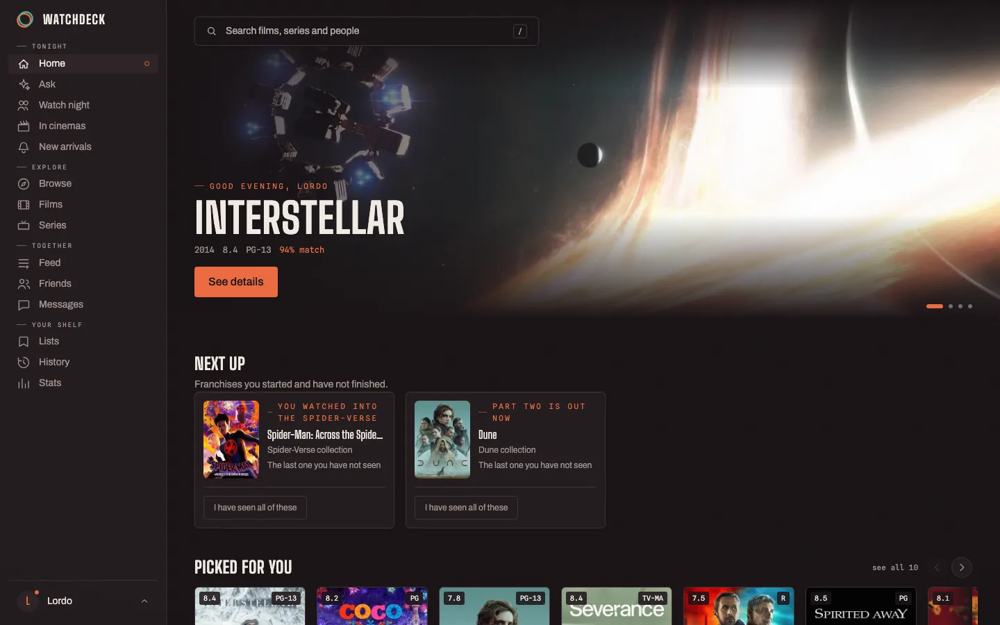
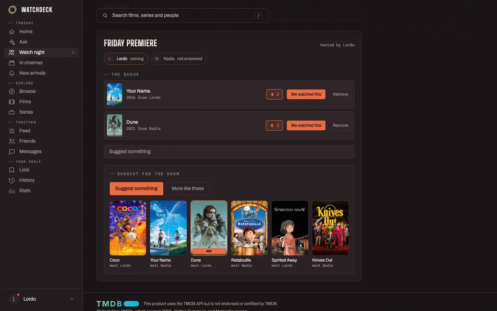
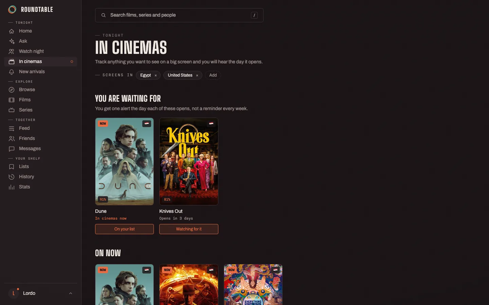
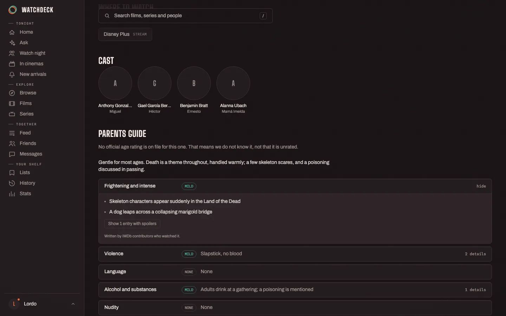
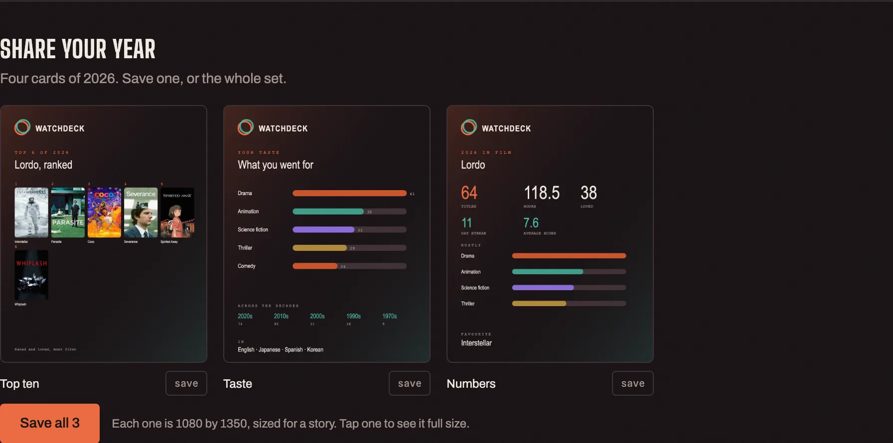

# Roundtable

Free, self-hosted film and series discovery. It learns your taste from what
you actually do, tells you which of your services has something in your
country, tracks series by the episode, warns you a week before a film opens
in your cinemas, and settles what to put on when there is more than one of
you.

Runs on your own machine. Nothing leaves it.

**[roundtable.watch](https://roundtable.watch)** · [What works](#what-works) · [Roadmap](ROADMAP.md)



---

## Why

Five streaming subscriptions and still nothing to watch. Films opening and
leaving the cinemas here before I heard about them. Where to watch it in one
app, what it is rated in another, my list in a third, and none of them
working properly outside a handful of markets.

So this is the one I wanted.

## What it does

**Recommendations that answer what you just did.** Opening a title, saving
it, rating it, clicking through to play it: all of it feeds one taste vector
per person. Shelves are re-ranked for quality, popularity and recency, then
deliberately spread across genres so you do not end up in a corridor of the
same four films.

**An exploration dial you can see.** Comfort, Balanced or Bold. Bold pulls
about a third of every shelf from outside your cluster, chosen from things
well enough liked to be a fair bet. A setting, not a hidden dial someone
else turns.

**Watch nights.** Invite two people or five. Everyone who accepts suggests
into the same queue and votes on it, and the suggestions are blended from
all of your tastes with a slider for who leans hardest tonight. Whatever
wins lands in every history at once, and a while later you are each asked
what you thought.



**Cinema alerts.** Put a film on the cinema list and you get one
notification a week before it opens in your country, which is enough notice
to make a plan with someone. One per film, no countdown, no daily nagging.



**Content advisories.** Five categories with a severity and itemised
entries, spoilers folded away until you ask. Off by default, set per
profile.



**Just ask.** Plain words, answered from your own history and the whole
catalog, showing its working as it goes. An MCP server ships with it, so
your own AI assistant can use your watch history too.

**A feed, and messages.** Post about what you watched, reply, share someone
else's post with your own take, and write to friends directly. Every part of
your profile is independently public, friends only or private.

**Series tracked by the episode.** A season grid per show, what you have
seen ticked off, and the next one to put on. Only episodes that have
actually aired count, so a show still running reads as up to date rather
than half finished, and you get one notification when a new episode lands.

**A browser extension, still finding its feet.** Manifest V3, no bundler,
no analytics. Importing your watchlist works on Netflix, Prime Video and
OSN+. Automatic play logging is written for those plus Disney+, Shahid, Max
and others, but it is unverified on every service, including Netflix. See
[What works](#what-works) before relying on it, and
[extension/README.md](extension/README.md) to help fix it.

**Your year, as something you can post.** Four cards drawn from your own
viewing, posters and faces and all, previewed in the app before you save
them. The raw numbers export as CSV or JSON whenever you like.



## Running it

You need Docker and a free [TMDB API key](https://www.themoviedb.org/settings/api).

```bash
git clone https://github.com/1ordo/roundtable
cd roundtable
cp .env.example .env      # then put your TMDB key in it
docker compose up -d
```

Open http://localhost:8080 and make the first account, which becomes the
admin. Registration closes behind it, so nobody else can walk in.

Everything except the TMDB key has a working default. The signing key is
generated on first boot and kept in the API's data volume; set
`RT_SECRET_KEY` yourself if you would rather manage it. If you reach the app
at anything other than localhost, set `RT_PUBLIC_BASE_URL` to match, and
leave `RT_COOKIE_SECURE=false` until you are behind HTTPS: browsers drop a
secure cookie on a plain-HTTP LAN address, and the symptom is a login that
appears to work and then bounces you back.

For local development with sample data and no keys at all:

```bash
./scripts/dev.sh up
```

That starts Postgres, Redis, the API, the worker and the web server, then
seeds two accounts. Other commands: `down`, `reset`, `seed`, `logs`.

### Configuration

Set through environment variables. Only the first is required.

| Variable | What it does |
|---|---|
| `RT_TMDB_API_KEY` | The catalog. Required. Free from TMDB. |
| `RT_OMDB_API_KEY` | Adds IMDb, Rotten Tomatoes and Metacritic scores. |
| `RT_PORT` | Which host port to serve on. Defaults to 8080. |
| `RT_PUBLIC_BASE_URL` | Where the app is reachable, for links in alerts. |
| `RT_COOKIE_SECURE` | Set true once you are behind HTTPS. False by default. |
| `RT_SECRET_KEY` | Signs sessions. Generated on first boot if you leave it empty. |
| `RT_DB_PASSWORD` | The bundled Postgres password. Internal to the compose network. |
| `RT_DEFAULT_COUNTRY` | Availability fallback before anyone picks a country. |
| `RT_OIDC_*` | Optional single sign-on, tested against Pocket ID. |
| `RT_RESEND_API_KEY` | Optional email alerts through Resend. |
| `RT_NTFY_URL` | Optional push through ntfy. Empty means off. |

The AI features are configured in the app under Admin, AI settings, rather
than in the environment, so a key can be rotated without a redeploy. Any
OpenAI-compatible endpoint works, including OpenRouter and a local Ollama.

Without a TMDB key there is no catalog. Without the rest there are simply
fewer features: embeddings are generated locally by default, so
recommendations work with no external AI service at all.

Keys live in `.env` and nowhere else. It is gitignored, it has never been
committed, and [SECURITY.md](SECURITY.md) says what to do if one ever slips.

### Signing in

Two methods, each switchable in Admin, and at least one always stays on:

- Username and password, argon2 hashed and rate limited.
- Passkey through Pocket ID (OIDC), if you run an identity server.

Open registration is off by default. The exception is an instance with no
accounts at all, which always lets the first person in: a fresh install
whose only way to open registration is behind an admin login has no way in
at all.

## What works

Written down so nobody finds out the hard way. This is the state of the
`main` branch, not a roadmap.

| Feature | Status | Notes |
|---|---|---|
| Catalog, search, title pages | Works | TMDB, with OMDb scores if you add a key. |
| Lists, watch history, export | Works | CSV and JSON. Posts and messages are not in the export yet. |
| Episode tracking | Works | Season grid, next up, per-episode logging. New in this release. |
| New-episode alerts | Works | Hourly check, one notice per episode. |
| Recommendations, exploration dial | Works | The dial changes the main shelf. Genre and mood shelves below it are similarity-ordered only. |
| Watch nights | Works | Multi-person taste blending, voting, and the result lands in every history. |
| Availability alerts | Works | Diffs the provider rows it saw last time, so it does not repeat itself. |
| Cinema alerts | Works | Fires a week before local release, once per film. Uses your primary country. |
| Friends, feed, direct messages | Works | Per-panel privacy is enforced server side. |
| Stats and year-in-review cards | Partial | Two of the four cards need at least three rated titles or three recognisable faces. |
| Content advisories | Partial | From IMDb's parents guide via an unofficial endpoint that can break without warning. Falls back to an estimate. |
| Imports | Partial | Netflix `ViewingActivity.csv` and `MyList.csv`. Unzip the GDPR archive yourself; uploading the zip is not supported. |
| Assistant and natural-language search | Partial | Needs an OpenAI-compatible endpoint. Title cards are checked against the catalog; the prose around them is not. |
| Vibe tags | Not yet | Needs a real embedding endpoint. The bundled local encoder is lexical and cannot do zero-shot labels, so it skips rather than inventing them. |
| MCP server | Works | Ten tools over a personal API token. No automated test coverage yet. |
| Browser extension, watchlist import | Works | Netflix, Prime Video, OSN+. |
| Browser extension, automatic play logging | **Unverified** | Written for eight services and confirmed on none. Help wanted. |
| Native mobile and desktop apps | Not yet | Planned. The API is token-ready for a non-browser client. |

Recommendations work with no AI service at all: embeddings are generated
locally by default. That local encoder is hashed n-grams rather than a
neural model, so it is fast and free and weaker at paraphrase than a real
embedding endpoint would be.

## How it is put together

```
api/        FastAPI, SQLAlchemy 2 async, Alembic, Pydantic v2
            arq worker on Redis for the crawler, alerts and imports
web/        React 19, Vite, TypeScript, Tailwind v4, TanStack Query
extension/  Manifest V3, plain files, node --test
db          Postgres 17 with pgvector
```

The recommendation engine is `api/app/ai/taste.py`. Local embeddings are in
`api/app/ai/local_embedding.py`.

The interface is its own design system, "The Projection Booth": a
two-strip Technicolor duotone where ember means films and actions, nitrate
means series and the system's own voice, set in Big Shoulders with an
academy-leader countdown when the app opens. The tokens and devices live in
`web/src/index.css`, and [CONTRIBUTING.md](CONTRIBUTING.md) explains how to
stay inside them.

Some decisions that are easy to get wrong and were deliberate:

- **Visibility is decided in one place** (`api/app/social/visibility.py`).
  A privacy setting that holds on the profile page and leaks through the
  comments feed is worse than no setting, so every endpoint goes through
  the same helper.
- **A comment and a post are one table.** A comment is a post that names a
  title. Reshares point at the original rather than nesting, so one delete
  cannot orphan a chain.
- **Alerts you switch off are never created**, rather than created and
  hidden. An inbox that fills with things you muted is not muted.
- **Marking a whole franchise watched tops each part up to a target**
  rather than incrementing, so a part you already logged is not counted
  twice.
- **Suggestions only include what you can actually watch tonight.** A film
  that is unreleased, or still only in cinemas, belongs on the cinema page
  rather than in a shelf.

## Developing

Requirements: Docker, Python 3.12, Node 22.

```bash
# infrastructure
docker compose -f compose.dev.yaml up -d

# backend
cd api
python3.12 -m venv .venv && .venv/bin/pip install -e '.[dev]'
.venv/bin/alembic upgrade head
.venv/bin/uvicorn app.main:app --reload --port 8000

# frontend
cd web
npm install && npm run dev
```

The Vite dev server proxies `/api` and `/auth` to port 8000. For pure
frontend work there is a mock API with believable data and no dependencies
at all: `node tests/mock-api.mjs` and you are signed in.

```bash
cd api && .venv/bin/python -m pytest   # disposable pgvector container
cd api && .venv/bin/ruff check app tests && .venv/bin/mypy app
cd web && npm run build
cd web && npm run test:e2e             # Playwright against the mock API
```

Tests run against a real Postgres with pgvector rather than a mock, so
migrations and vector queries are covered.

Database changes go through Alembic:

```bash
cd api
.venv/bin/alembic revision --autogenerate -m "what changed"
```

Read the generated migration before committing. Autogenerate will happily
write a `NOT NULL` column with no server default, which aborts on any table
that already has rows.

## Contributing

Yes, please. [CONTRIBUTING.md](CONTRIBUTING.md) is the whole book: how to
get a dev environment in five minutes, a tour of the codebase, the design
system rules, how the tests work, and what a good pull request looks like
here. Security reports go through [SECURITY.md](SECURITY.md) instead of the
issue tracker.

## Repository layout

- `api/` application, worker, migrations, tests
- `web/` React app, nginx config, Playwright tests, screenshot generator
- `extension/` the browser extension
- `branding/` logo and brand assets
- `docs/` plan and operations guide
- `compose.yaml` production compose

## Attribution

This product uses the TMDB API but is not endorsed or certified by TMDB.
Ratings come from OMDb, which sources IMDb, Rotten Tomatoes and Metacritic.

## Licence

[GNU AGPL v3](LICENSE). Run it, change it, fork it, host it for other
people, charge for it if you like. The one condition that matters: if you
offer a modified version to anyone over a network, you have to publish your
changes under the same licence. That is section 13, and it is the reason
this licence rather than the GPL.

The name and the logo are not covered by it. See [TRADEMARK.md](TRADEMARK.md),
which is short and mostly says yes.

Contributions are under the same licence, certified with a
[Developer Certificate of Origin](https://developercertificate.org/) sign-off.
There is no copyright assignment and no CLA: what you write stays yours.
